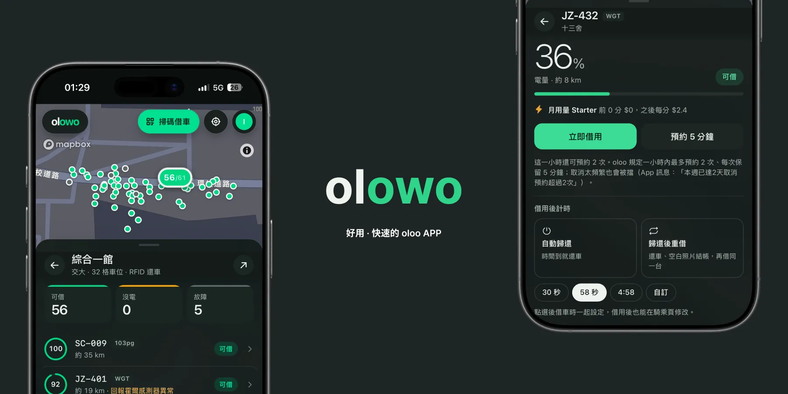

# olowo

一個更快、更好用、甚至讓你免費騎，把電量、定位、錯誤說清楚的第三方 oloo Web/PWA client。



線上版：<https://olowo.emtech.cc>（用 oloo 帳號的 Email 登入）

## 功能

- **站點地圖**：每站標出「可借 / 停放」台數（例如 `1/5`），畫出電子圍籬，非營運區變暗；校區總覽直接看可借、沒電、故障各幾台。
- **具體電量**：點進站點看每台車的電量 %、預估續航、車型，以及為什麼借不到（沒電、故障、被預約）；點一台車會標出它的 GPS 位置。
- **借車**：立即借用、預約 5 分鐘（倒數計時，顯示這一小時還能預約幾次），也可以掃 QR Code 或輸入車號。
- **定時**：騎滿指定時間就自動歸還，或歸還後自動以空白照片結帳再重借同一台；預設 30 秒、58 秒、4:58，也能自訂，騎乘中隨時改。由伺服器執行，關掉網頁也會跑。
- **還車與結帳**：按下歸還就停止計費，直接跳到結帳，空白照片已自動附上，一鍵付款。
- **騎乘紀錄**：每趟的費用、騎乘與臨停分鐘、發動與熄火秒數、起訖站點，以及最近 30 天統計。
- **各種方案**：看校區可訂閱的方案與能否購買，付款前先試算，可購買、加值時數、取消自動續約或更改下期方案；也列出其他校區、活動限定與已下架的方案，方便比較。
- **優惠券**：列出可用與已使用的優惠券、兌換代碼，購買方案或加值時套用。
- **PWA**：手機與桌機都能用，可以加到主畫面。

## 開發

```sh
pnpm install
cp .env.example .env                           # 填 SESSION_ENCRYPTION_KEY（openssl rand -hex 32）與 Mapbox token
cp apps/api/.env.example apps/api/.env         # 同一把 SESSION_ENCRYPTION_KEY
cp apps/web/.env.example apps/web/.env.local   # Mapbox public token
docker compose up -d db                        # 本機 PostgreSQL，session 重啟 API 也不會掉
pnpm dev
```

Web 為 `http://127.0.0.1:5173`，API 為 `http://127.0.0.1:8787`。瀏覽器一律呼叫同源的 `/v1/*`（開發時由 Vite proxy，部署時由 Caddy 反向代理到 Fastify），讓 session cookie 維持 first-party。

## 部署

同一份 `compose.yaml`：

```sh
docker compose up -d --build   # db + api + web（Caddy），預設 http://localhost:8080
```

要用自己的網域時，在 `.env` 設 `SITE_ADDRESS=olowo.example.com`、`PUBLIC_ORIGIN=https://olowo.example.com`，並開放 80／443（`HTTP_PORT`、`HTTPS_PORT`），Caddy 會自動申請 HTTPS 憑證。

資料庫 schema 在 `apps/api/sql/schema.sql`，API 每次啟動都會以 `CREATE … IF NOT EXISTS` 套用；目前還沒部署過，所以沒有 migration。未設定 `DATABASE_URL` 時 API 改用記憶體（重啟即登出），只適合測試。

## 授權與聲明

olowo 由 毛哥EM 製作，以 [Apache License 2.0](LICENSE) 授權。

**免責聲明**：本專案僅供學術研究用途，與 oloo 官方無關，也未經其授權或背書。使用時請遵守 oloo 的服務條款（ToS），因使用本專案產生的任何後果由使用者自行負責。
