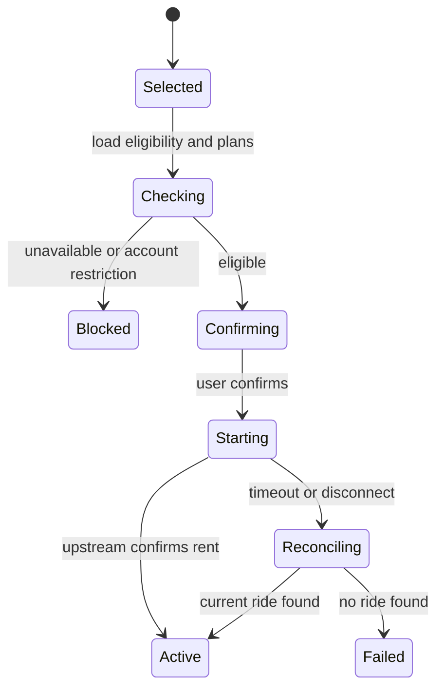
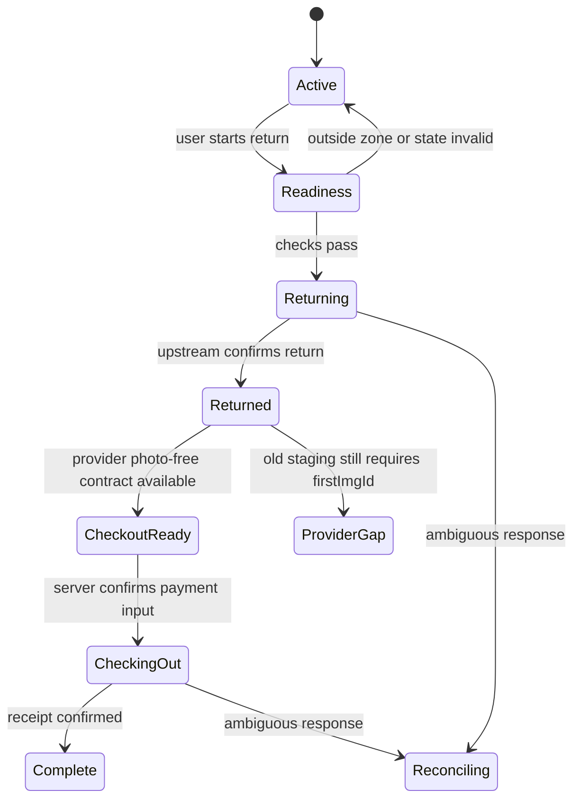

# olowo product and architecture specification

## Product promise

olowo is a mobile-first Web/PWA client that helps oloo riders answer three questions quickly:

1. Which nearby scooter can I actually borrow?
2. How much battery and range does it have, and where exactly is it?
3. While riding, when should I return it and what must I do to finish safely?

It keeps oloo's green identity but does not copy the current app's information architecture. The primary surface is a full-bleed live map of stations, with a panel floating over it: a draggable bottom sheet on phones and a left-hand panel on desktop. Statistics explain the map; they are not a separate dashboard users must understand first.

## Experience principles

- Show numbers, not decorative status icons: `72%`, `1.2 km`, `更新 18 秒前`.
- Separate official facts from olowo inference. Every inferred unavailable reason carries a confidence level.
- Make one primary action obvious on each screen.
- Keep warnings adjacent to the action they affect.
- Keep authoritative timers on Fastify; browser timers are display-only.
- Preserve ride completion state through refreshes, crashes, and flaky uploads.
- Use concise Traditional Chinese. Avoid eyebrow labels, motivational filler, and redundant explanations.

## Information architecture

| Route           | Primary job                                                              |
| --------------- | ------------------------------------------------------------------------ |
| `/map`          | find a borrowable scooter and understand nearby availability             |
| `/scooters/:id` | inspect one scooter, battery, position age, plan and eligibility         |
| `/ride`         | control the current ride, timer, cost, return readiness and upload state |
| `/activity`     | inspect rides, bills and receipts                                        |
| `/insights`     | compare station risk and unavailable-reason statistics                   |
| `/account`      | email session, payment summary, plan, permissions and privacy controls   |

Mobile navigation should expose Map, Ride, Activity and Account. Ride replaces its normal tab state when an active ride exists. Insights is reachable from the map's availability summary rather than occupying permanent navigation.

## Core screens

### Nearby scooters

- The map fills the viewport and shows stations. Each station pin shows its borrowable count; color encodes whether anything is borrowable.
- Opening a station (pin or list row) fans its scooters out around the pin, each showing battery percentage, and lists them with range and concise availability.
- The panel lists stations nearest to the rider (or to the map centre before location is granted) with walking time and a dock composition bar; no address selector is shown.
- A compact summary such as `212 台可借 · 81 個站點` sits at the top of the panel.
- Controls stay minimal: station search (name or campus) and an "available only" toggle. No battery floor; battery is shown per scooter once a station is opened.
- Cluster dense points without hiding the available/unavailable ratio.

### Unavailable summary

- Counts for low battery, in use, hardware, location, communication and unknown.
- Counts are scoped to the current viewport or selected station.
- Multi-label reasons are disclosed; the primary-reason view uses documented precedence.
- Selecting a reason filters markers, but individual markers do not need a long reason label.

### Current ride

- Elapsed time and estimated current charge dominate the screen.
- Return-by target and next billing boundary are visible without scrolling.
- A rider can choose automatic return or return-and-reborrow after 0:28, 1:28, 2:28 or a custom duration. Destructive choices require an explicit confirmation and remain cancellable before execution.
- Power/lock controls appear only when the current ride and upstream permission allow them.
- Return readiness checks current ride ownership and vehicle identity before the server sends a return command.

### Return and checkout

- The rider stops and locks the scooter, then confirms return.
- The server re-reads the active ride and requires the ride ID and scooter ID to match before returning.
- oloo still requires a return photo (`firstImgId`) for checkout. After return the PWA shows the final bill, asks for a genuine photo, lets the rider choose a card and oloo coin use, and pays. olowo never uploads blank or stock images.
- An unpaid ride survives refreshes: the PWA keeps a 「待結帳」 shortcut until checkout succeeds.

## Feature decision table

| Requested idea                            | Product decision                           | Reason                                                                                 |
| ----------------------------------------- | ------------------------------------------ | -------------------------------------------------------------------------------------- |
| exact battery percentage                  | build in MVP                               | directly available in scooter status                                                   |
| exact scooter location                    | build in MVP with freshness/accuracy       | coordinates are available; stale/invalid GPS must be explicit                          |
| unavailable-reason counts                 | build in MVP as explained inference        | supported by joined status and report evidence                                         |
| automatic return                          | implemented with confirmation and recheck  | CEO authorized; job locks to one active ride and stops on ambiguity                    |
| return and automatically reborrow at 1:29 | implemented as explicit opt-in             | confirms next billing segment, rechecks ride, returns first, and never retries failure |
| return photo and card checkout            | implemented; not exercised with real money | contract recovered from the capture; genuine photo only                                |
| reservation                               | implemented: immediate 5-minute hold only  | countdown from oloo's expiry; olowo shows the rider's recent reservation/cancel count  |
| scheduled reservation                     | removed                                    | not needed                                                                             |
| email login                               | implemented and staging-verified           | exact six-digit OTP endpoints recovered and tested                                     |

## Recommended monorepo

```text
olowo/
├── apps/
│   ├── web/                  # React, Vite, PWA, TanStack Query, Zustand
│   └── api/                  # Fastify, PostgreSQL, scheduler and upstream proxy
├── packages/
│   ├── contracts/            # shared TypeScript schemas and public DTOs
│   ├── availability/         # pure join/classification rules
│   ├── config/               # tsconfig, eslint and shared tooling
│   └── ui/                   # deliberate shared primitives, not page components
├── docs/
└── scripts/research/
```

The web app uses a feature-oriented layout:

```text
apps/web/src/
├── app/
├── features/
│   ├── auth/
│   ├── map/
│   ├── scooter/
│   ├── ride/
│   ├── return-photo/
│   ├── reservations/
│   └── insights/
├── shared/
│   ├── api/
│   ├── ui/
│   └── lib/
└── styles/
```

Pages compose features; features do not import pages. TanStack Query owns server state. Zustand is limited to ephemeral UI state such as map viewport, filters and an in-progress return wizard. Persisted ride truth always comes from the API.

## Backend responsibilities

Fastify is not a thin CORS relay. It is the security and reliability boundary:

1. exchange and protect provider credentials;
2. issue opaque HttpOnly sessions;
3. fetch and join fleet snapshots;
4. remove operational secrets and PII;
5. cache with ETag-aware refresh and publish small deltas;
6. enforce current-user ownership on mutations;
7. apply idempotency and current-state reconciliation to rent/return/reservation;
8. execute ride and reservation timers independently of browser suspension;
9. retain provider credentials only in memory or encrypted PostgreSQL storage;
10. keep checkout/photo state explicit until the provider's new no-photo contract exists.

Recommended public endpoints:

| Method         | Route                          | Purpose                                                      |
| -------------- | ------------------------------ | ------------------------------------------------------------ |
| POST           | `/v1/auth/email/start`         | begin captured provider email flow                           |
| POST           | `/v1/auth/email/verify`        | verify and create olowo session                              |
| POST           | `/v1/auth/logout`              | revoke local session and provider credential where supported |
| GET            | `/v1/map/stations`             | stations with their sanitized scooter DTOs                   |
| GET            | `/v1/map/availability-summary` | reason counts for bounds/station                             |
| GET            | `/v1/rides/current`            | canonical current ride and completion state                  |
| POST           | `/v1/rides`                    | borrow with idempotency key                                  |
| POST           | `/v1/rides/:id/return`         | request return and reconcile upstream state                  |
| GET/PUT/DELETE | `/v1/rides/:id/automation`     | inspect, configure or cancel a ride timer                    |
| GET            | `/v1/reservations/current`     | normalized current reservation                               |
| POST/DELETE    | `/v1/reservations[/:id]`       | create or cancel a reservation                               |

## PostgreSQL model

Store only data required for user-facing continuity and auditing:

```text
users
sessions
provider_credentials       # encrypted, never queryable by browser
fleet_snapshots            # short TTL, sanitized fields only
ride_sessions              # current state and upstream reconciliation ids
ride_actions               # idempotency key, desired action, result, request id
return_uploads              # owner, ride, hash, size, upstream image id, status
cost_guards                 # threshold, notification status, confirmation state
reservations               # normalized provider state
audit_events               # redacted actor/action/outcome only
```

Do not retain raw full-fleet payloads, BLE keys, ICCIDs, device phone numbers, photo EXIF or precise user tracks in the application database.

## State machines

### Borrow



### Return and planned photo-free checkout



## Scheduling model

A PWA timer is suitable for visible countdowns, not authoritative state changes. olowo uses this order:

1. browser timer while visible;
2. service-worker notification where supported;
3. a Fastify timer for the selected action;
4. one explicit confirmation when a destructive timer is created;
5. server rechecks the exact current ride and scooter before returning;
6. reborrow is attempted only after return succeeds and is never automatically retried.

With PostgreSQL configured, every scheduled-action transition is persisted and pending/interrupted jobs are restored at API startup using an unexpired encrypted provider session. An overdue action executes immediately only after the same state checks. Without PostgreSQL, the development fallback is process-resident and intentionally makes no restart guarantee.

## Validation gates before live mutations

- email authentication contract captured and verified with the authorized account;
- obtain an operator-approved staging account and known staging scooter;
- reservation create/cancel requests recovered from the app and implemented;
- confirm photo size, type and content rules;
- confirm the operator's final photo-free checkout contract;
- exercise timeout/retry/idempotency cases;
- verify no token, PII, device secret or EXIF enters logs;
- add a runtime kill switch for every mutation family;
- review the final workflow with oloo before production use.
