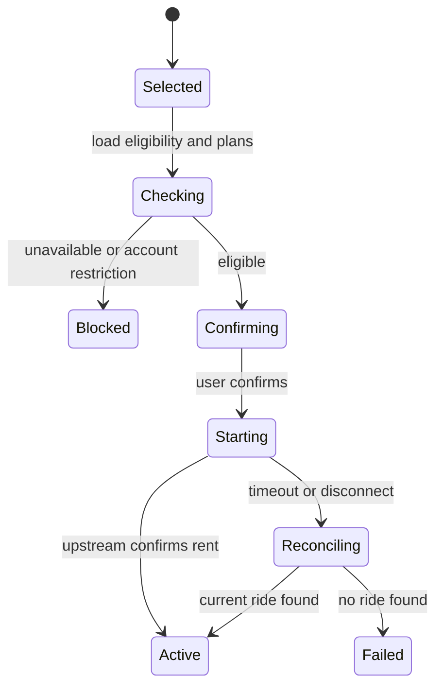
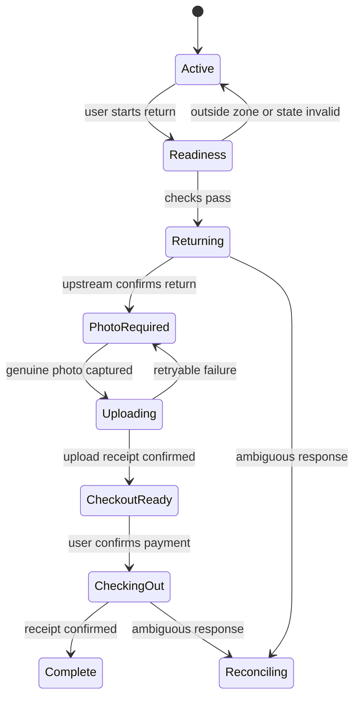

# oluwu product and architecture specification

## Product promise

oluwu is a mobile-first Web/PWA client that helps oloo riders answer three questions quickly:

1. Which nearby scooter can I actually borrow?
2. How much battery and range does it have, and where exactly is it?
3. While riding, when should I return it and what must I do to finish safely?

It keeps oloo's green identity but does not copy the current app's information architecture. The primary surface is a live map with a compact, data-rich bottom sheet. Statistics explain the map; they are not a separate dashboard users must understand first.

## Experience principles

- Show numbers, not decorative status icons: `72%`, `1.2 km`, `更新 18 秒前`.
- Separate official facts from oluwu inference. Every inferred unavailable reason carries a confidence level.
- Make one primary action obvious on each screen.
- Keep warnings adjacent to the action they affect.
- Never claim a background timer is exact when the browser cannot guarantee it.
- Preserve ride completion state through refreshes, crashes, and flaky uploads.
- Use concise Traditional Chinese. Avoid eyebrow labels, motivational filler, and redundant explanations.

## Information architecture

| Route           | Primary job                                                              |
| --------------- | ------------------------------------------------------------------------ |
| `/map`          | find a borrowable scooter and understand nearby availability             |
| `/scooters/:id` | inspect one scooter, battery, position age, plan and eligibility         |
| `/ride`         | control the current ride, timer, cost, return readiness and upload state |
| `/activity`     | inspect rides, bills and receipts                                        |
| `/insights`     | compare station risk and unavailable-reason statistics                   |
| `/account`      | email session, payment summary, plan, permissions and privacy controls   |

Mobile navigation should expose Map, Ride, Activity and Account. Ride replaces its normal tab state when an active ride exists. Insights is reachable from the map's availability summary rather than occupying permanent navigation.

## Core screens

### Map

- Full-bleed map with exact scooter points, station areas and optional e-fence layers.
- Scooter marker displays battery percentage; color encodes availability, not battery alone.
- A selected-scooter sheet shows label, battery, estimated range, exact update age, station, plan estimate and one primary borrow action.
- A compact summary such as `附近 24 台 · 9 台可借` opens reason statistics.
- Filter controls: available only, battery floor, model, position freshness and e-fence layer.
- Cluster dense points without hiding the available/unavailable ratio.

### Unavailable summary

- Counts for low battery, in use, hardware, location, communication and unknown.
- Counts are scoped to the current viewport or selected station.
- Multi-label reasons are disclosed; the primary-reason view uses documented precedence.
- Selecting a reason filters markers, but individual markers do not need a long reason label.

### Current ride

- Elapsed time and estimated current charge dominate the screen.
- Return-by target and next billing boundary are visible without scrolling.
- A cost guard notifies at a user-selected time or projected amount and requires confirmation before return.
- Power/lock controls appear only when the current ride and upstream permission allow them.
- Return readiness checks location/e-fence, scooter state, network and camera/storage before the user starts the final flow.

### Return photo

- Capture a genuine image in-app.
- Downscale and compress locally to a documented maximum before upload.
- Strip unnecessary EXIF while preserving orientation.
- Store the pending blob in IndexedDB until an upload receipt is confirmed.
- Resume upload and checkout after refresh or crash.
- Never substitute a blank, stock, or unrelated image and never claim the provider requirement can be skipped.

## Feature decision table

| Requested idea                            | Product decision                             | Reason                                                                                |
| ----------------------------------------- | -------------------------------------------- | ------------------------------------------------------------------------------------- |
| exact battery percentage                  | build in MVP                                 | directly available in scooter status                                                  |
| exact scooter location                    | build in MVP with freshness/accuracy         | coordinates are available; stale/invalid GPS must be explicit                         |
| unavailable-reason counts                 | build in MVP as explained inference          | supported by joined status and report evidence                                        |
| timed return                              | build as notification plus user confirmation | PWA background timers are not exact; return changes billing/state                     |
| automatic return                          | gated experiment only                        | requires server scheduling, idempotency, operator agreement and staging vehicle tests |
| return and automatically reborrow at 1:29 | do not ship                                  | can double-charge, lose the vehicle, bypass availability rules or leave unsafe state  |
| skip return photo                         | do not implement                             | captured checkout uses an uploaded image ID; bypass semantics are unproven            |
| upload a smaller photo                    | build safely                                 | compress a genuine image and make upload resumable                                    |
| scheduled reservation                     | design now; enable after mutation capture    | current reservation reads exist, but create/cancel contracts are missing              |
| email login                               | build after capturing auth flow              | APK proves email flows exist, but HAR lacks endpoint contracts                        |

## Recommended monorepo

```text
oluwu/
├── apps/
│   ├── web/                  # React, Vite, PWA, TanStack Query, Zustand
│   └── api/                  # Fastify, PostgreSQL, scheduler and upstream proxy
├── packages/
│   ├── contracts/            # shared TypeScript schemas and public DTOs
│   ├── availability/         # pure join/classification rules
│   ├── config/               # tsconfig, eslint and shared tooling
│   └── ui/                   # deliberate shared primitives, not page components
├── docs/
└── scripts/research/
```

The web app uses a feature-oriented layout:

```text
apps/web/src/
├── app/
├── features/
│   ├── auth/
│   ├── map/
│   ├── scooter/
│   ├── ride/
│   ├── return-photo/
│   ├── reservations/
│   └── insights/
├── shared/
│   ├── api/
│   ├── ui/
│   └── lib/
└── styles/
```

Pages compose features; features do not import pages. TanStack Query owns server state. Zustand is limited to ephemeral UI state such as map viewport, filters and an in-progress return wizard. Persisted ride truth always comes from the API.

## Backend responsibilities

Fastify is not a thin CORS relay. It is the security and reliability boundary:

1. exchange and protect provider credentials;
2. issue opaque HttpOnly sessions;
3. fetch and join fleet snapshots;
4. remove operational secrets and PII;
5. cache with ETag-aware refresh and publish small deltas;
6. enforce current-user ownership on mutations;
7. apply idempotency and reconciliation to rent/return/checkout;
8. compress/validate upload metadata and retain upload receipts;
9. deliver cost-guard notifications;
10. write redacted audit events.

Recommended public endpoints:

| Method | Route                          | Purpose                                                      |
| ------ | ------------------------------ | ------------------------------------------------------------ |
| POST   | `/v1/auth/email/start`         | begin captured provider email flow                           |
| POST   | `/v1/auth/email/verify`        | verify and create oluwu session                              |
| POST   | `/v1/auth/logout`              | revoke local session and provider credential where supported |
| GET    | `/v1/map/scooters`             | region-bounded sanitized fleet DTOs                          |
| GET    | `/v1/map/availability-summary` | reason counts for bounds/station                             |
| GET    | `/v1/rides/current`            | canonical current ride and completion state                  |
| POST   | `/v1/rides`                    | borrow with idempotency key                                  |
| POST   | `/v1/rides/:id/return`         | request return and reconcile upstream state                  |
| POST   | `/v1/rides/:id/photo`          | upload genuine compressed return image                       |
| POST   | `/v1/rides/:id/checkout`       | checkout with confirmed image receipt                        |
| PUT    | `/v1/rides/:id/cost-guard`     | configure notification threshold                             |
| GET    | `/v1/reservations/current`     | normalized current reservation                               |

## PostgreSQL model

Store only data required for user-facing continuity and auditing:

```text
users
sessions
provider_credentials       # encrypted, never queryable by browser
fleet_snapshots            # short TTL, sanitized fields only
ride_sessions              # current state and upstream reconciliation ids
ride_actions               # idempotency key, desired action, result, request id
return_uploads              # owner, ride, hash, size, upstream image id, status
cost_guards                 # threshold, notification status, confirmation state
reservations               # normalized provider state
audit_events               # redacted actor/action/outcome only
```

Do not retain raw full-fleet payloads, BLE keys, ICCIDs, device phone numbers, photo EXIF or precise user tracks in the application database.

## State machines

### Borrow



### Return and checkout



## Scheduling model

A PWA timer is suitable for visible countdowns, not authoritative state changes. Cost guards use this order:

1. browser timer while visible;
2. service-worker notification where supported;
3. server-scheduled push notification for app-closed reliability;
4. user confirmation opens the ride screen;
5. server rechecks the current ride, location and price before returning.

No server job should automatically reborrow. If automatic return is ever approved, it must be opt-in per ride, show the exact consequence, have a cancel window, lock to one ride ID, use an idempotency key, reconcile after timeouts, and stop rather than retry when state is ambiguous.

## Validation gates before live mutations

- capture the email authentication flow without placing credentials in the HAR;
- obtain an operator-approved staging account and known staging scooter;
- document reservation create/cancel requests;
- confirm photo size, type and content rules;
- confirm whether return and checkout are independently reversible;
- exercise timeout/retry/idempotency cases;
- verify no token, PII, device secret or EXIF enters logs;
- add a runtime kill switch for every mutation family;
- review the final workflow with oloo before production use.
